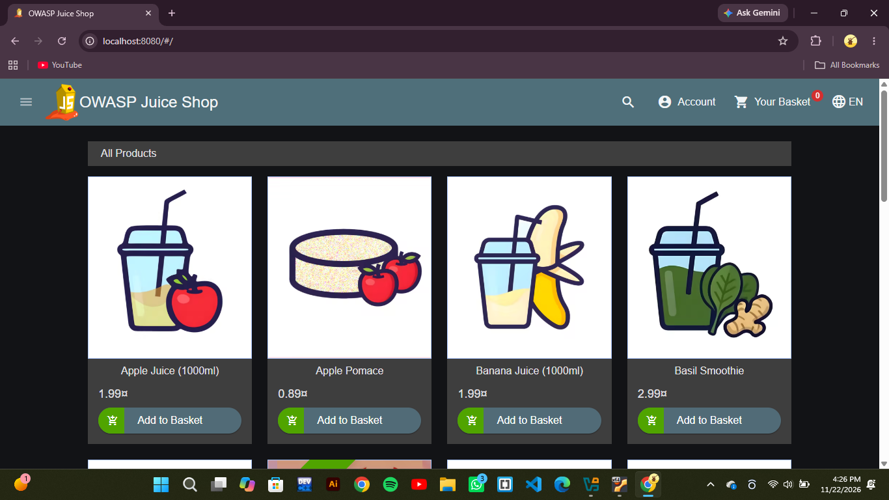

# Vulnerable Lab Scope of Work

An isolated VirtualBox lab running OWASP Juice Shop on localhost, with a Scope of Work defining legal and technical boundaries: own lab only, no external targets, synthetic data.

## Contents

- [Scope_of_Work.md](Scope_of_Work.md): scope and rules of engagement
- [images/lab-screenshot.png](images/lab-screenshot.png): the running app
- [images/vm-docker-status.png](images/vm-docker-status.png): container running in the VM

## Lab Summary

- **VM:** Ubuntu 26.04 in VirtualBox
- **App:** OWASP Juice Shop (Docker)
- **Access:** http://localhost:8080 (port forward to guest port 3000)

## Screenshot

## Lab Setup

1. Install VirtualBox and create an Ubuntu 26.04 VM (4 GB RAM, 2 CPUs, 25 GB disk).
2. Set the network to NAT with a port forward: host port 8080 to guest port 3000.
3. Install Docker inside the VM: `sudo apt install -y docker.io`
4. Start the app: `sudo docker run -d --name juice-shop -p 3000:3000 bkimminich/juice-shop`
5. Open http://localhost:8080 on the host to reach the app.
6. After a reboot, restart it with `sudo docker start juice-shop`.

## Shutdown

Run `sudo poweroff` in the VM when finished. The lab is only used while the VM is running.

Training exercise only. No external systems are tested and all data is synthetic.